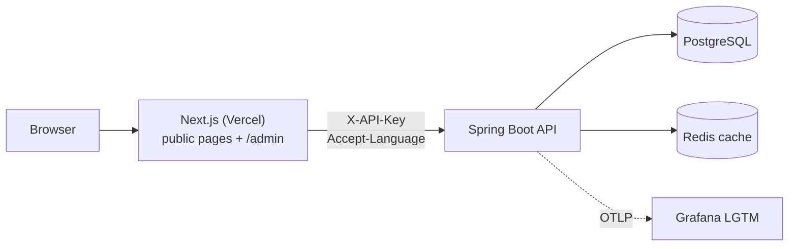

# olekshyr-dev-api

[](https://github.com/olekshyr/olekshyr-dev-api/actions/workflows/maven.yml)


The backend API for my personal site. It serves a **multilingual blog** (English,
Ukrainian, Japanese) to a Next.js frontend, and it's where I put into practice how I
think a small production service should be built: secured, observable and tested
against real infrastructure, with no more complexity than the problem needs.

> The resume, projects and landing pages are static in the Next.js app. The blog is
> the only feature backed by this API.

## Architecture



- **Server-to-server only.** Only the Next.js server calls the API, so it has no CORS
  setup, and the API keys never reach the browser.
- **Two API keys, kept strictly apart:** a public key for read routes and an admin key
  for `/api/v1/admin/**`. Each key works only on its own routes
  ([ADR-001](docs/adr/ADR-001-api-key-authentication.md)).
- **Admin identity stays in the frontend.** The planned `/admin` UI signs in with GitHub
  OAuth and is limited to one account. The API only checks the admin key.

## Highlights

| Area | What it does |
|---|---|
| **i18n** | The locale comes from `Accept-Language` (`en`, `uk`, `ja`; default `en`), never from the URL. Responses carry `Content-Language` and `Vary: Accept-Language`, so HTTP caches keep languages apart. |
| **Publishing model** | Each translation of a post is published on its own. Its first publication date survives unpublishing and re-publishing. A post's slug is shared across locales and frozen once the post is first published. Deleted posts are soft-deleted, and their slugs stay reserved. |
| **Errors** | One error envelope with stable machine codes (`TRANSLATION_NOT_AVAILABLE`, `SLUG_FROZEN`, …) and messages localized in all three languages. A test fails the build if any code is missing a translation. |
| **Security** | Constant-time key comparison and stateless security filter chains. Blog HTML is sanitized on write with the OWASP Java HTML Sanitizer, using an allowlist that matches CKEditor 5. Bean Validation checks every admin request. SpotBugs with FindSecBugs runs in CI. |
| **Caching** | Public reads are cached in Redis and cleared after every admin write commits. The cache can never fail a request: if Redis is down, requests fall back to Postgres, and an entry in an outdated shape counts as a miss. |
| **Observability** | OpenTelemetry traces, logs and metrics over OTLP, with logs correlated to traces. Error responses include the `traceId`. |
| **Testing** | Integration tests run against real PostgreSQL and Redis through Testcontainers (no in-memory database), plus fast unit tests for the domain rules. |
| **Code health** | Spotless (Prettier) formatting and SpotBugs run in CI on every pull request. Module boundaries follow Spring Modulith conventions, and the schema is migrated with Flyway. |

The full set of design decisions, each with its reasoning, is in
[`docs/blog-implementation-plan.md`](docs/blog-implementation-plan.md#agreed-decisions).

## API at a glance

All routes need the `X-API-Key` header. List endpoints are paginated with
`?page=0&size=10` (`size` is capped at 50).

**Public** (public key, content in the `Accept-Language` locale)

| Method & path | Description |
|---|---|
| `GET /api/v1/posts` | Posts visible in the locale, newest first |
| `GET /api/v1/posts/{slug}` | One post, including `availableLocales` for hreflang |

**Admin** (admin key, every locale at once, posts addressed by numeric id)

| Method & path | Description |
|---|---|
| `GET /api/v1/admin/posts?deleted=` | List posts with each translation's status |
| `GET /api/v1/admin/posts/{id}` | Draft preview: every translation, in any status |
| `POST /api/v1/admin/posts` | Create a post |
| `PUT /api/v1/admin/posts/{id}` | Change the slug (only before the first publish) |
| `DELETE /api/v1/admin/posts/{id}` | Soft delete (idempotent) |
| `PUT /api/v1/admin/posts/{id}/tags` | Replace the post's tags |
| `PUT /api/v1/admin/posts/{id}/translations/{locale}` | Create or replace a translation |
| `POST /api/v1/admin/posts/{id}/translations/{locale}/publish` | Publish a translation |
| `POST /api/v1/admin/posts/{id}/translations/{locale}/unpublish` | Unpublish a translation |
| `GET, POST /api/v1/admin/tags` · `GET, PUT, DELETE /api/v1/admin/tags/{id}` | Manage tags |

Example:

```bash
curl -H "X-API-Key: $PUBLIC_API_KEY" -H "Accept-Language: uk" \
  http://localhost:8080/api/v1/posts/hello-world
```

An error looks like this (the message follows `Accept-Language`):

```json
{
  "code": "TRANSLATION_NOT_AVAILABLE",
  "message": "This post is not available in the requested language.",
  "timestamp": "2026-10-22T12:00:00Z",
  "path": "/api/v1/posts/hello-world",
  "traceId": "4bf92f3577b34da6a3ce929d0e0e4736"
}
```

Swagger UI is at `/swagger-ui.html`. It needs the public key too, unless
`APP_DOCS_PUBLIC=true` (see below).

## Tech stack

Java 25 (GraalVM CE) · Spring Boot 4 (Web MVC, Data JPA, Security, Validation, Cache) ·
PostgreSQL + Flyway · Redis · OpenTelemetry + Grafana LGTM · Testcontainers · Spring
Modulith · springdoc-openapi · OWASP Java HTML Sanitizer · Spotless · SpotBugs +
FindSecBugs · GitHub Actions

## Running locally

**Prerequisites:** JDK 25 (`sdk env install` picks the version from `.sdkmanrc`) and
Docker.

1. Create a `.env` file in the project root. It's git-ignored and imported
   automatically.

   | Variable | Required | Purpose |
   |---|---|---|
   | `PUBLIC_API_KEY` | yes | Key for the public routes |
   | `ADMIN_API_KEY` | yes | Key for `/api/v1/admin/**` |
   | `APP_SECURITY_HEADER_NAME` | no | Header carrying the key (default `X-API-Key`) |
   | `APP_DOCS_PUBLIC` | no | `true` serves Swagger UI without a key (keep it off in prod) |
   | `OTLP_TRACING_ENDPOINT`, `OTLP_LOGGING_ENDPOINT`, `OTLP_METRICS_ENDPOINT` | no | Where to export telemetry; when unset, nothing is exported |
   | `TRACING_SAMPLING_RATE` | no | Trace sampling (default `0.1`) |

2. Start the app. Spring Boot's Docker Compose support brings up PostgreSQL, Redis and
   Grafana from `compose.yaml` and wires the app to them:

   ```bash
   ./mvnw spring-boot:run
   ```

   The API runs on `http://localhost:8080`, and Grafana on `http://localhost:3001`.

On Windows, use `mvnw.cmd` instead of `./mvnw`.

## Building and testing

```bash
./mvnw verify            # build, all tests, Spotless and SpotBugs checks (needs Docker)
./mvnw test -Dtest=PostApiIntegrationTest   # a single test class
./mvnw spotless:apply    # format the code
```

CI runs `./mvnw -B verify` on every pull request to `main`.

## Project layout

```
src/main/java/dev/olekshyr/api/
├── blog/       # entities, repositories, public and admin APIs, sanitizer, caches
├── security/   # API-key filters and security filter chains
├── shared/     # error handling, locale, pagination, clock, cache plumbing
└── logging/    # OpenTelemetry log bridge, OTLP endpoint mapping
src/main/resources/db/migration/   # Flyway migrations
docs/                              # project plan, blog plan, ERD, ADRs
```

## Documentation

- [Project plan](docs/project-plan.md): scope, architecture, security baseline, roadmap
- [Blog implementation plan](docs/blog-implementation-plan.md): the agreed decisions and the phases
- [Blog data model (ERD)](docs/erd-blog.md)
- [Architecture decision records](docs/adr/README.md)
- [Glossary](GLOSSARY.md): the domain terms the code uses

## Status

**Done:** domain model and schema, public read API, admin write API, Redis caching, CI.

**Next:** grouped OpenAPI docs for the frontend, the first deployment (Dockerfile,
managed Postgres and Redis), rate limiting on public routes, and connecting the
Next.js frontend.

**Later:** filter by tag, site search (Postgres full-text), media uploads and cover
images.
